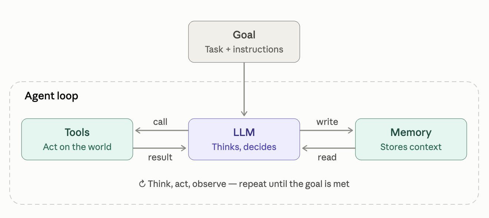
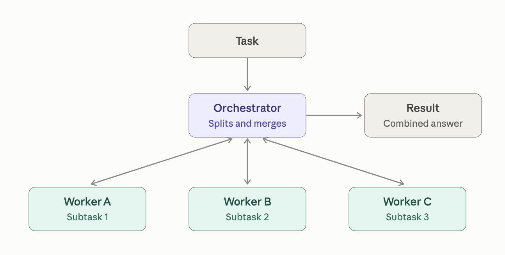
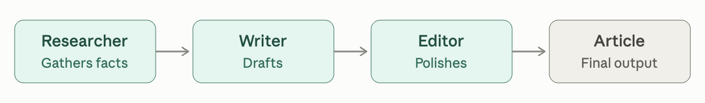
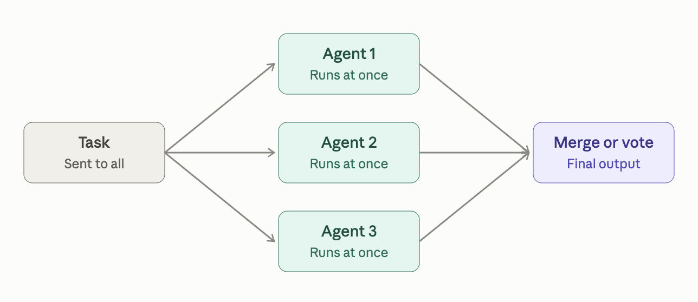
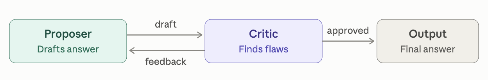
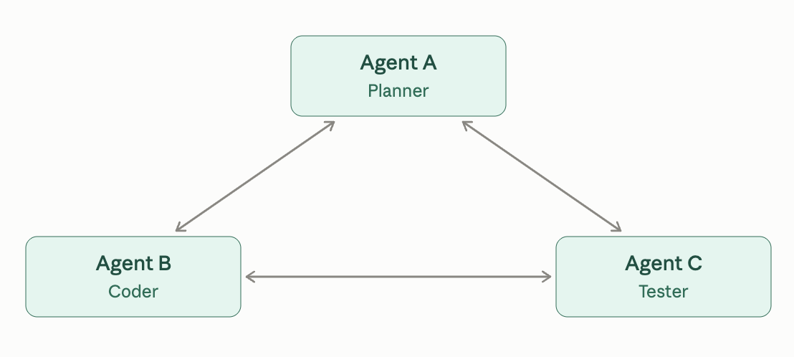

# Agents & Multi-agent Systems 

## Agent

An agent is what you get when you let a model take actions in a loop toward a goal — it decides what to do, does it, observes the result, and decides again, until the goal is met or it gives up. 

 

Three properties make something an agent: 

1. Tool use — it can act on the world (search, call APIs, read/write files, run code), not just emit words. 

2. Autonomy over control flow — it decides the sequence of steps, rather than a developer hardcoding them. The path isn't known in advance. 

3. Feedback loops — it observes the outcome of each action and adapts, so later steps depend on what earlier ones returned. 

 

## Multi-agent Systems 

A multi-agent system is a setup where several AI agents work together to accomplish a task. Each agent has its own LLM, tools, memory and loop but usually with a narrower role. 

Instead of one agent doing everything, the work is split up. 

For example, A coding system might have one agent that plans, one that writes code, one that tests, and one that reviews. 

 

### Benefits of using more than one agent 

* **Focus:** each agent gets a short, specific prompt and only the tools it needs, so it performs better at its job. 

* **Context limits:** a single agent’s context window fills up on big tasks. Subagents can each read a lot and return only a short summary. 

* **Speed:** independent subtasks can run in parallel. 

* **Checks and balances:** a separate reviewer agent hasn’t seen how the work was produced, so it judges the output more objectively.

 

### The trade-offs 

* **Complexity:**  Multi-agent systems are complex to build and maintain in comparison to single agent systems. 

* **Cost:** more agents means more model calls and more tokens, often several times more than one agent. 

* **Coordination problems:** agents can misunderstand each other, duplicate work, or lose important details when handing off. 

* **Harder to debug:** when something goes wrong, it’s harder to trace which agent caused it. 

 

### Common patterns 

 

#### 1. Orchestrator–worker (manager and subagents): 
A lead agent breaks the task into parts, hands each part to a worker agent, then combines the results. This is the most common pattern today, used in many research and coding agents. 

 

 

#### 2. Pipeline (sequential):
Agents pass work down a line, like an assembly line. Each agent’s output becomes the next agent’s input. 

 
 
 

#### 3. Parallel:
Several agents tackle different pieces, or the same piece, at the same time. Their outputs are then merged, or put to a vote to pick the best one. 

 

#### 4. Debate or critique:
One agent proposes and another critiques. They go back and forth until the critic is satisfied, which catches mistakes a single agent would miss. 

 
 

#### 5. Peer collaboration:
Agents talk to each other freely, with no single boss. This is flexible but harder to control, so it’s less common in production. 

 