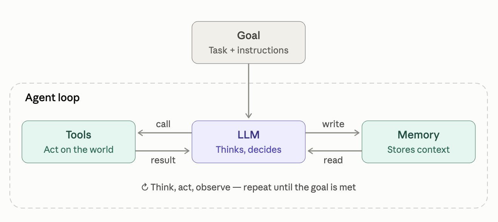

# Why do we need libraries? 

### Control flow: 
branching, retries, timeouts, step limits, and fallbacks when a tool fails or the model returns something malformed. 

 
### Multi-agent orchestration:
routing work between agents, passing state between them, running branches in parallel, and merging results. 

 

### Provider lock-in with custom code 

If you write custom code directly on one provider’s SDK, your code becomes tied to that provider’s specific formats: 

* **Message format:** how roles, system prompts, and multi-part content (text, images, files) are structured. 
 
* **Tool calling:** how tool schemas are defined, how the model returns a tool call, and how you send the result back. These differ across providers in small but breaking ways. 

* **Streaming events:** each provider emits different event types and orders, so your streaming and UI code is provider-specific. 

* **Provider-only features:** prompt caching, extended thinking, built-in web search, and structured output modes work differently or don’t exist elsewhere. 

* **Errors and limits:** rate-limit handling, retries, and token counting are all written against one API. 

 

## Available popular agentic frameworks

| Framework | Language | Main strength |
|-----------|----------|---------------|
| LangGraph | Python, JS | Explicit graph control with checkpointing, pause/resume, and human-in-the-loop for long-running, stateful agents |
| CrewAI | Python | Role-based "crews" that make multi-agent teams quick and intuitive to set up |
| Agno | Python | Very fast and lightweight, with built-in memory, knowledge, and multimodal support plus a runtime for deploying agents |
| Pydantic AI | Python | Type-safe agents with validated tool inputs and structured outputs |
| OpenAI Agents SDK | Python, JS | Simple primitives for handoffs between agents, guardrails, and tracing |
| Microsoft Agent Framework | Python, .NET | Enterprise-grade agents with deep Azure integration, successor to AutoGen and Semantic Kernel |
| Strands Agents | Python, TS | Model-driven agents from AWS with minimal code, fitting naturally into AWS and Bedrock |
| Claude Agent SDK | Python, TS | The same agent loop that powers Claude Code, with built-in file, shell, and tool handling |

